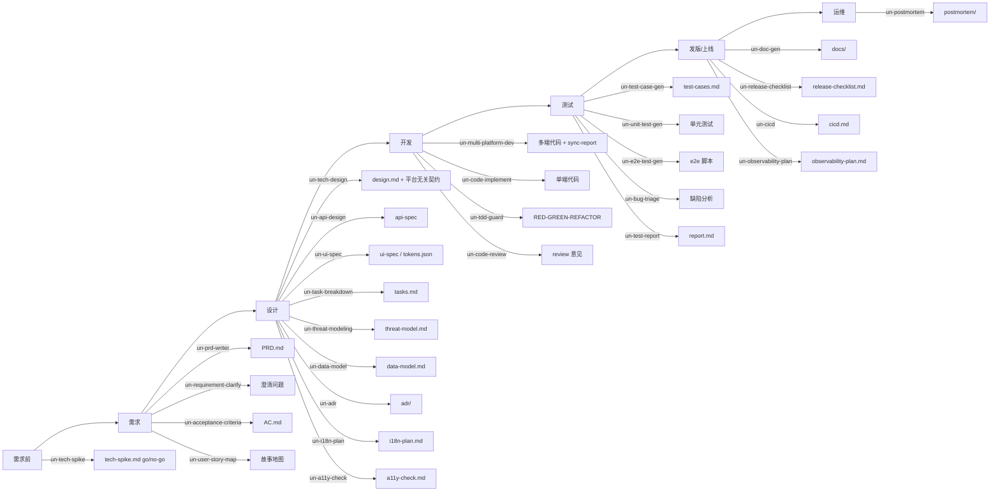

# Hardercoder/skills

A collection of **Agent Skills** built on the open [agentskills.io](https://agentskills.io) standard, so every skill here works the same way in **WorkBuddy, Claude Code, Cursor, and Codex**.

> Each skill is a folder with a `SKILL.md` (frontmatter: `name` + `description`). Bundled skills use a `un-` prefix to avoid name collisions across tools.

## Repository layout

```
skills/                      (this repo root)
├── README.md               ← you are here
├── LICENSE
├── .gitignore
└── sdlc-flow/              ← full SDLC plugin (PRD → design → dev → test, + discipline & missing stages)
    ├── plugin.md           plugin manifest + routing + contract notes
    ├── .claude-plugin/      Claude Code plugin manifest (plugin.json)
    ├── shared/              17 cross-stage templates (PRD/AC/design/tasks/test/report + spike/threat/data-model/adr/i18n/a11y/doc/release/observability/postmortem)
    └── skills/             34 skills, one folder each
```

## Install

Pick the tool you use. The **whole `sdlc-flow/` folder** must be copied together (its `shared/` templates are referenced relatively).

| Tool | How to install |
|---|---|
| **WorkBuddy** | Already symlinked if you built it locally; otherwise copy `sdlc-flow/` into your skills dir. Invoke by naming the skill in chat. |
| **Claude Code** (standalone) | Copy `sdlc-flow/skills/*` into `~/.claude/skills/` (or your project `.claude/skills/`). |
| **Claude Code** (as plugin) | `claude --plugin-dir /path/to/sdlc-flow` → skills become `/sdlc-flow:<skill>`. |
| **Cursor** | Copy `sdlc-flow/` into `.cursor/skills/` (or `~/.cursor/skills/`). |
| **Codex** | Copy `sdlc-flow/skills/*` into `~/.codex/skills/` or repo `.agents/skills/`. |

**Invoke a skill**

| Tool | Syntax |
|---|---|
| WorkBuddy | mention the skill name, e.g. “写个 PRD” → `un-prd-writer` |
| Claude Code (standalone) | `/un-prd-writer` |
| Claude Code (plugin) | `/sdlc-flow:un-prd-writer` |
| Cursor | `/un-prd-writer` |
| Codex | `$un-prd-writer` |

> In non-WorkBuddy tools the `un-sdlc-orchestrator` drives the pipeline by *instructions* (it tells the agent which skill to load next) rather than an automatic RPC call — functionally equivalent, just not a hard function call.

## sdlc-flow — full lifecycle plugin

`un-sdlc-orchestrator` is the optional entry point: hand it a one-line requirement and it walks PRD → design → dev → test, writing each stage's artifact to a `.sdlc/` folder in your workspace and feeding it to the next stage. Every skill also works **standalone** — you don't have to run the whole pipeline.



> **Methodology discipline layer** (new): `un-tdd-guard`, `un-systematic-debugging`, `un-verify-before-done`, `un-git-worktree`, `un-parallel-agents` — these enforce *how* to build (inspired by the Superpowers philosophy: process over prompts, verify before claiming done), and can be invoked at any phase.

### The 34 skills

**Phase skills (17, original)** — see `sdlc-flow/plugin.md` for the full per-skill table; key ones:

| Stage | Skill | Produces | Notes |
|---|---|---|---|
| — (router) | `un-sdlc-orchestrator` | pipeline state in `.sdlc/` | optional glue; sub-skills callable alone |
| Requirement | `un-prd-writer` | `PRD.md` | accepts 飞书/腾讯文档 links or pasted text |
| Design | `un-tech-design` | `design.md` + platform-agnostic contract | contract feeds `un-multi-platform-dev` |
| Development | `un-multi-platform-dev` | multi-platform code + sync-report | spec-first, Python drift-check scripts |
| Testing | `un-test-report` | `report.md` | coverage, runs, residual risk |

**Methodology discipline layer (6, new)** — *how* to build, not *what* to produce:

| Skill | Enforces |
|---|---|
| `un-tdd-guard` | RED-GREEN-REFACTOR; failing test before any code; delete code written without a test |
| `un-systematic-debugging` | 4-phase root cause: reproduce → locate → root-cause → fix+verify |
| `un-verify-before-done` | evidence-based completion gate, not a claim |
| `un-git-worktree` | isolate parallel work, keep main tree clean |
| `un-parallel-agents` | dispatch independent tasks to fresh sub-agents |
| `un-skill-authoring` | meta: author new skills per this repo's conventions |

**Missing stages (11, new)** — fill gaps before/after the core pipeline:

| Stage | Skill | Produces |
|---|---|---|
| Pre-requirement | `un-tech-spike` | `tech-spike.md` (go/no-go) |
| Design | `un-threat-modeling` | `threat-model.md` (STRIDE) |
| Design | `un-data-model` | `data-model.md` |
| Design | `un-adr` | `adr/<nnn>.md` |
| Design-UI | `un-i18n-plan` | `i18n-plan.md` |
| Design-UI | `un-a11y-check` | `a11y-check.md` |
| Post-dev | `un-doc-gen` | `docs/` (README/API/runbook/guide) |
| Post-test | `un-release-checklist` | `release-checklist.md` |
| Post-test | `un-cicd` | `cicd.md` + pipeline config |
| Pre-prod | `un-observability-plan` | `observability-plan.md` |
| Ops | `un-postmortem` | `postmortem/<date>.md` (blameless) |

### Key design point — the contract bridge

`un-tech-design` ends its `design.md` with a **platform-agnostic contract** section whose fields align with `un-multi-platform-dev`'s `feature-contract.md` (see `sdlc-flow/shared/contract-bridge.md`). That means for multi-platform work the design artifact is the **single source of truth** — no re-specifying the spec in code. `un-multi-platform-dev`'s `drift_check.py` can even report divergences back into the design doc, closing the loop.

### Notes & limits

- **Distribute the whole `sdlc-flow/` folder**, not a single skill — `shared/` templates and sibling-skill references (`../../shared/...`, `../un-multi-platform-dev/...`) resolve only within the full package.
- **Inputs**: PRDs may arrive as 飞书/腾讯文档; UI specs may arrive as MasterGo/Figma exports. The skills read those instead of inventing content.
- **Portability**: all paths are relative; no hardcoded machine paths. The `un-multi-platform-dev` Python scripts run anywhere with Python 3.

## License

See [LICENSE](./LICENSE).
